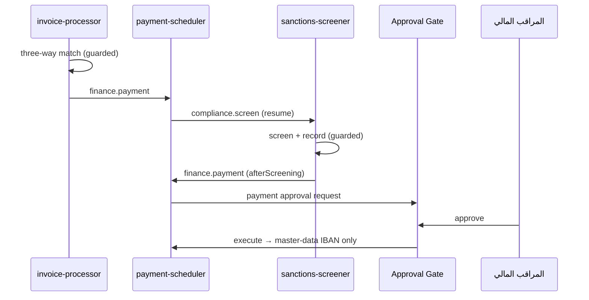

# مجال المالية: الذمم الدائنة

| الوكيل | المسمى | مؤشر الأداء | صلاحية تحريك المال |
|--------|--------|-------------|---------------------|
| [`invoice-processor`](invoice-processor/README.md) | AP Invoice Specialist | دقة ≥ 98%، وصفر فواتير احتيالية تصل للدفع | لا |
| [`payment-scheduler`](payment-scheduler/README.md) | Payments Specialist | صفر دفعات خاطئة في الربع | نعم، بموافقة بشرية فقط |

## التدفق

## طبقات الحماية من الاحتيال البنكي (BEC)

1. **`assess_invoice`:** يكشف اختلاف حساب الفاتورة عن السجل الرئيسي، فيعلّق الفاتورة ويصعّد بخطورة critical.
2. **`assess_payment`:** يعيد الفحص نفسه قبل الدفع.
3. **`schedule_payment`:** لا يقبل حسابًا أو مبلغًا من الوكيل، والمستفيد من السجل الرئيسي فقط.
4. **الـ connector:** يرفض أي حساب لا يطابق السجل الرئيسي، وأي مبلغ يتجاوز المبلغ الموافق عليه.
5. **تغيير الحساب الرئيسي:** إجراء `master_data_change` بموافقتين دائمًا، وليس لأي وكيل أداة له.

## المشترك: `shared/`

| الملف | المحتوى |
|-------|---------|
| `invoice-assessment.ts` | المطابقة الثلاثية وكشف التكرار والاحتيال |
| `payment-assessment.ts` | جاهزية الدفع |
| `policy.ts` | هامش السعر 2%، وهامش الحساب 0.01 |
| `tools/` | أدوات القراءة المشتركة |
| `guardrails/` | `same-task-invoice` |

## مستقبلي

- **استخراج الفواتير من PDF أو البريد:** بـ OCR مع Claude vision، ويحتاج تقييمًا مستقلًا للدقة.
- **خصومات السداد المبكر وتحسين توقيت الدفع:** يحتاجان بيانات الخزينة والسيولة.
- **إرسال إشعارات الرفض للموردين:** إجراء `external_send`.
- **المطابقة البنكية والإقفال الشهري.**
